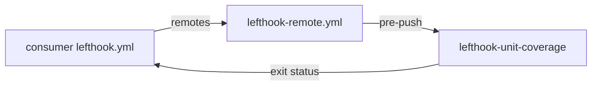
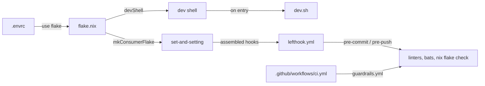

# nix-lefthook-unit-coverage

<!-- hallucinogen:autonomy-disclaimer start -->
> Read [LLM-DISCLAIMER](docs/LLM-DISCLAIMER.md) first. This repository is
> tended by an autonomous loop, and that file says what the loop may do here,
> what it may not, and what to check before trusting anything in this tree.
<!-- hallucinogen:autonomy-disclaimer end -->

[](https://github.com/pr0d1r2/nix-lefthook-unit-coverage/actions/workflows/ci.yml) [](https://nixos.org)

> This code is LLM-generated and validated through an automated integration
> process using [lefthook](https://github.com/evilmartians/lefthook) git hooks,
> [bats](https://github.com/bats-core/bats-core) unit tests, and GitHub Actions CI.

Lefthook-compatible test coverage check, packaged as a Nix flake.

Verifies every implementation file has a corresponding test spec. Supports
multiple languages and test frameworks via TOML configuration.

## Configuration

Create `.unit-coverage.toml` in your repo root:

```toml
allowlist = ".coverage-allowlist"   # optional, default

[[rules]]
glob = "*.sh"
dirs = ["scripts/just", "nix/fragments", "nix/dev"]
test_dir = "tests/unit"
pattern = "mirror"
test_ext = "bats"
exclude = ["scripts/lefthook"]
normalize = true

[[rules]]
glob = "*.rb"
dirs = ["app", "lib"]
test_dir = "spec"
pattern = "mirror"
strip = "app"
test_suffix = "_spec"
exclude = ["vendor"]
```

### Rule fields

| Field | Default | Description |
|-------|---------|-------------|
| `glob` | *(required)* | File extension pattern (e.g. `*.sh`, `*.rb`) |
| `dirs` | *(required)* | Source directories to scan |
| `test_dir` | *(required)* | Root directory for test files |
| `pattern` | `mirror` | `mirror` (preserve dir tree) or `flat` (stem only) |
| `test_ext` | same as source | Override test file extension (e.g. `bats` for `.sh` files) |
| `test_suffix` | `""` | Suffix added to stem (e.g. `_spec`, `_test`) |
| `strip` | `""` | Prefix stripped from impl path before mapping (e.g. `app`) |
| `normalize` | `false` | Convert underscores to dashes in stem |
| `exclude` | `[]` | Directory prefixes to skip |

### Mapping examples

| Rule | Input | Output |
|------|-------|--------|
| mirror, test_ext=bats | `scripts/just/build.sh` | `tests/unit/scripts/just/build.bats` |
| mirror, strip=app, suffix=_spec | `app/models/user.rb` | `spec/models/user_spec.rb` |
| mirror, suffix=_test | `app/controllers/foo.rb` | `test/controllers/foo_test.rb` |
| flat, suffix=_test | `lib/bundix/convert.rb` | `test/convert_test.rb` |
| mirror, normalize | `nix/dev/shell_hook.sh` | `tests/unit/nix/dev/shell-hook.bats` |

## Architecture



## Usage

### Option A: Lefthook remote (recommended)

```yaml
remotes:
  - git_url: https://github.com/pr0d1r2/nix-lefthook-unit-coverage
    ref: main
    configs:
      - lefthook-remote.yml
```

### Option B: Flake input

```nix
inputs.nix-lefthook-unit-coverage = {
  url = "github:pr0d1r2/nix-lefthook-unit-coverage";
  inputs.nixpkgs.follows = "nixpkgs";
};
```

### Environment variables

| Variable | Default | Description |
|----------|---------|-------------|
| `LEFTHOOK_UNIT_COVERAGE_TIMEOUT` | `30` | Timeout in seconds |
| `LEFTHOOK_UNIT_COVERAGE_CONFIG` | `.unit-coverage.toml` | Path to config file |
| `LEFTHOOK_UNIT_COVERAGE_ROOT` | git root | Override repo root (for testing) |

## Development architecture



## License

MIT
